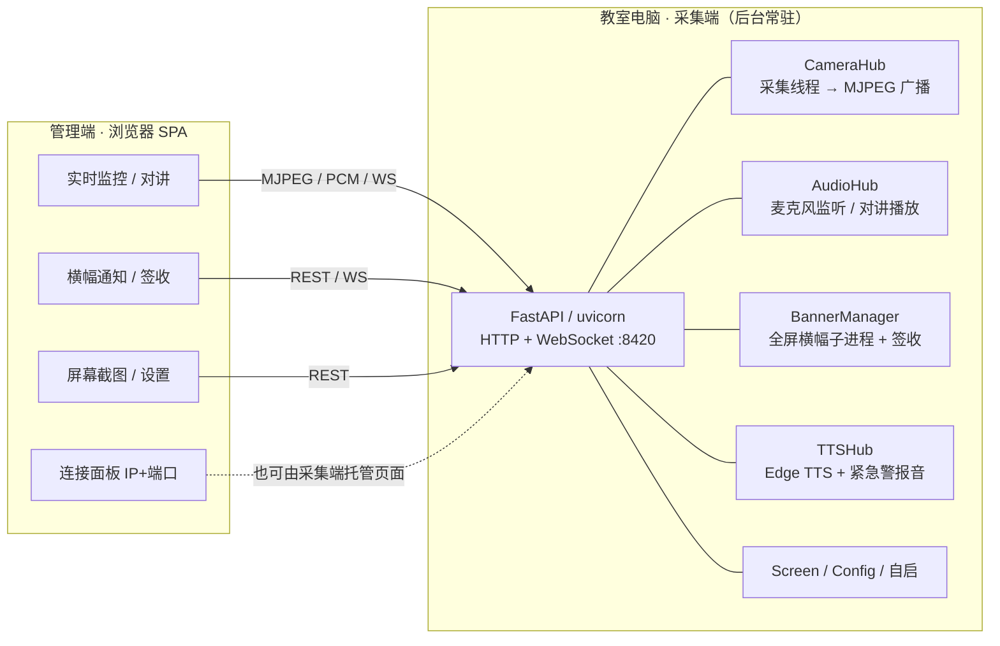
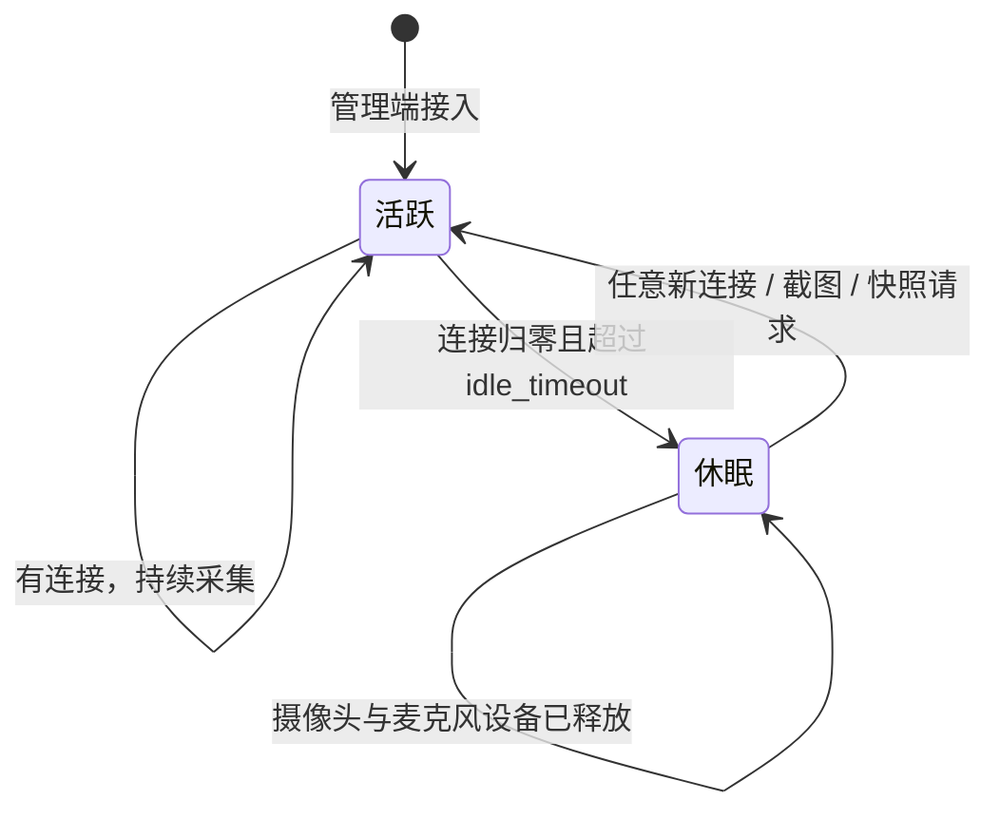

# ClassConnector · 班级连接器

一套部署在**教室电脑（采集端）**与**教师浏览器（管理端）**之间的局域网工具：采集端开机自启、后台常驻，管理端在 Web 上输入设备 IP + 端口即可连接，进行实时画面查看、麦克风对讲、Markdown 横幅通知、语音播报与屏幕截图。

> 设计目标：**不依赖云服务器、不依赖公网**。所有能力都跑在局域网内，一个 Python 进程 + 一个浏览器页面即可工作。

> **v1.2.0 重要更新**
> - 新增**桌面版 `ClassConnector.exe`**：双击即打开图形设置窗口，服务在后台自动运行，**不需要 .bat、不需要命令行、不需要用户安装 Python**（exe 自带运行时）。主窗口只有设置：摄像头、播报语音、音效、网络与安全；底部状态栏显示局域网地址。
> - **摄像头主机侧锁定**：默认只有教室电脑上的设置窗口能枚举并选择本机摄像头；Web 管理端只能使用主机指定的那一路画面，`/api/camera/devices` 不返回其他设备，网络侧也无法自行解锁。需放开时在设置窗口勾选即可。
> - **Web 端 icon 与桌面应用完全一致**（同一份 `assets/icon.*`，含 favicon / PWA / apple-touch-icon），管理端新增竖屏与窄屏响应式布局。
> - 保留 v1.1.0 的修复：`.bat` 纯 ASCII + CRLF、绿色便携版、Python 3.8 兼容、`ClassConnector.sln` Visual Studio 解决方案。
>
> 请从 [Releases](https://github.com/ssq0324/ClassConnector/releases) 下载 **`ClassConnector.exe`**（推荐）或 `ClassConnector-v1.2.0.zip` 源码包；v1.0.0 已废弃。

---

## 一、需求对照

| 位置 | 需求 | 实现方式 |
| --- | --- | --- |
| 采集端 | 开机自启 | 安装器注册 Windows 注册表 Run / Linux XDG autostart（可选 systemd）/ macOS LaunchAgent |
| 采集端 | 后台运行 | Windows `pythonw.exe` 无窗口启动，POSIX 分离会话；日志写入文件，可选系统托盘 |
| 采集端 | 退出需要安装密码 | 安装时用 PBKDF2-HMAC-SHA256 + 随机盐保存密码；`/api/agent/stop`、改密、关闭自启均校验密码 |
| 采集端 | 支持局域网管理 | 监听 `0.0.0.0:8420`，内置 HTTP/WebSocket 服务并开放 CORS，可被任意管理端跨源连接 |
| 采集端 | 无设备连接时休眠 | 连接数 + 视频流订阅数归零且超过 `idle_timeout` 后，暂停摄像头/麦克风线程并释放设备；有新连接立即唤醒 |
| 管理端 | Web 上输入 IP + 端口连接 | 连接面板填写地址，或直接在浏览器打开 `http://设备IP:端口` 自动连接；支持保存/切换多台设备 |
| 管理端 | 查看指定摄像头画面、设置画质、听声音 | MJPEG 推流；可调分辨率 / JPEG 质量 / 帧率；16 kHz PCM 监听，音量可调。**摄像头设备只能由主机设置窗口选定**，管理端默认无法枚举或切换本机其他摄像头 |
| 采集端 | 图形化设置、运行 exe | `ClassConnector.exe`（PyInstaller 单文件、无控制台）打开纯设置主窗口；摄像头 / 语音 / 音效 / 端口 / 密码均可在窗口里修改 |
| 管理端 | 麦克风对讲（对讲时关闭音频） | 浏览器录音重采样后经 WebSocket 上传；开启对讲时采集端**立即停止推送教室音频**，避免啸叫与回声 |
| 管理端 | 横幅通知：Markdown 长文本、签收按钮、Edge TTS 播报、紧急事件独立音频 | 全屏置顶窗口渲染 Markdown（可滚动），签收状态实时回传；`edge-tts` 朗读；紧急事件使用红色样式并先播放独立警报音 |
| 管理端 | 截取屏幕内容 | PNG 截图，支持多显示器与缩放；无图形会话时返回占位图并明确标记 |

---

## 二、架构



**两种使用方式**

1. **直连（最简单）**：在任意浏览器打开 `http://<教室电脑IP>:8420`。页面由采集端自己托管，会自动识别并连接本机。
2. **集中管理（推荐多班级）**：把 `manager/` 目录放到教师机或任意静态服务器（甚至直接用 `python -m http.server`），在页面里填写每台设备的 IP + 端口，可保存多台随时切换。服务端已开放 CORS，跨源访问不受限。

更多细节见 [docs/ARCHITECTURE.md](docs/ARCHITECTURE.md)。

---

## 三、快速开始

### 0. 桌面版 exe（推荐：双击即用，无需 Python / 无需 .bat）

下载 `ClassConnector.exe` 后**双击**即可：

1. 弹出 **「ClassConnector · 设置」** 图形窗口，服务在后台线程自动启动。
2. 在窗口里设置：摄像头（本机枚举、分辨率、帧率、JPEG 画质）、播报语音与音效、班级名称、端口、空闲休眠、访问密码，以及**是否允许管理端切换摄像头**。
3. 底部状态栏显示局域网地址，同网段任意浏览器打开该地址即进入管理端；点「打开管理端」也可直接打开本机页面。
4. 退出时若设置了密码会要求输入；**删除文件夹即卸载**——不写注册表、不注册自启、不装系统 Python，数据全部在 `data/`。

exe 由 [`.github/workflows/build-exe.yml`](.github/workflows/build-exe.yml) 在 Windows runner 上自动构建（PR 的 Checks / Release 资产均可下载），也可自行编译：

```bat
pip install -r requirements-build.txt
python scripts/make_icons.py
python scripts/build_exe.py        :: -> dist\ClassConnector.exe
```

源码环境下可直接 `python -m agent.desktop` 打开**同一个**设置窗口。详见 [桌面版说明](docs/DESKTOP.md)。

### 0.2 绿色便携脚本（可选，需要 Python 3.8+）

保留脚本方式供开发 / Linux / macOS 使用。解压 zip 后：

| 系统 | 启动 |
| --- | --- |
| Windows | 双击 `scripts/start-portable.bat` |
| Linux / macOS | `bash scripts/start-portable.sh` |

首次运行会在**解压目录内**创建 `runtime/venv` 并安装核心依赖（不写系统 Python），随后自动启动服务并打开浏览器。配置、日志、横幅、语音缓存只写入 `data/`；**不写注册表、不注册自启、不建系统服务或托盘**。退出按 `Ctrl+C`，卸载直接删除整个文件夹。

- 退出密码（可选）：双击 `scripts/set-password.bat`
- 完整功能依赖：`runtime\venv\Scripts\python.exe -m pip install -r requirements.txt`
- 详见 [绿色版说明](docs/PORTABLE.md) 与解压目录里的 `PORTABLE.txt`

### 1. 教室电脑安装采集端（需要开机自启时）

要求 **Python 3.8+**（Windows / Linux / macOS 均可）。

| 系统 | 安装 |
| --- | --- |
| Windows | 双击 `scripts/install.bat` |
| Linux / macOS | `bash scripts/install.sh` |
| 任意系统（命令行） | `python -m agent.install` |

安装向导会依次询问：

- 班级 / 教室名称
- 监听端口（默认 `8420`）
- **退出密码**（至少 4 位，PBKDF2 加盐保存，配置文件不存明文）
- 是否开机自启并后台运行
- 是否立即启动

无人值守 / 批量部署：

```bash
python -m agent.install --yes --password MyPass123 --room "高三(1)班" --port 8420
```

安装后检查状态：

```bash
python -m agent.control status
python -m agent.control open     # 打开管理端网页
```

> Linux 无图形会话（服务器版）请用 `python -m agent.install --systemd` 注册 systemd user service，而不是 XDG 桌面自启。

### 2. 打开管理端

浏览器访问 **`http://<教室电脑IP>:8420`**，或打开独立部署的管理端页面填写 IP + 端口。连接成功后会自动开启实时画面。

首次使用建议先在「设备设置」确认摄像头索引、音频设备与可选依赖状态。

---

## 四、功能使用

### 实时画面与画质

- 「画质设置」卡片可调整 **JPEG 质量（10–100）/ 分辨率 / 帧率 / 摄像头设备**，即时生效并自动重载画面。
- 多个管理端同时观看时，采集端只占用一次摄像头，通过广播分发，不会成倍增加负载。
- 未检测到摄像头时会输出带班级名、IP 与时间戳的**动态测试画面**，便于联调。

### 声音监听与对讲

- 点击「开启监听」后浏览器通过 Web Audio 播放教室麦克风声音（16 kHz / 单声道 PCM），可拖动音量。浏览器要求用户手势后才能播放音频，因此需点击按钮。
- 点击「开始对讲」（或**按住空格键**）开启麦克风对讲。开启瞬间采集端停止推送教室音频并清空缓冲，结束后自动恢复监听。
- 对讲状态会同步给所有管理端，避免多人同时讲话造成混乱。

### 横幅通知

- 正文支持 **Markdown 长文本**：标题、粗体/斜体/删除线、列表与任务清单、引用、代码块、表格、链接、分割线；编辑区右侧实时预览。
- 可选 **需要签收**：横幅底部出现签收按钮，学生点击后状态实时回传到管理端「通知历史」。
- 可选 **语音播报**：用 `edge-tts` 朗读标题 + 正文（自动去掉 Markdown 标记），管理端可选择中文语音。
- 勾选 **紧急事件** 时：横幅变红色紧急样式，播报前先播放一段**独立的双音警报**（本地生成 `<数据目录>/urgent.wav`，可自行替换为任意 wav），与常规通知声音明显区分。
- 支持自动关闭秒数、`0` 表示需手动关闭 / 签收；支持撤回、重发与网页全屏预览。
- 采集端无图形桌面会话时，横幅不会弹窗，管理端可用「网页预览」查看并代签收。

### 屏幕截图

「屏幕截图」标签页选择显示器与缩放比例后一键抓取，可下载 PNG 或按 5/10/30 秒自动刷新。

### 设备设置与退出

可修改班级名、设备名、休眠超时、默认语音、各功能开关；可开启「需要管理密码登录」（开启后所有管理操作都需先用安装密码登录）。**退出 / 重启采集端必须输入安装密码**，防止被随意关闭。

---

## 五、休眠机制

`Runtime` 维护「管理端 WebSocket 连接数 + MJPEG 流订阅数」：



休眠时摄像头采集线程暂停并 `release()` 设备、音频流关闭；横幅、TTS、对讲控制通道仍然可用。`idle_timeout` 默认 20 秒，设为 `0` 表示不休眠。

---

## 六、可选依赖与降级

核心只依赖 `fastapi` + `uvicorn`。其余均为可选，缺失时对应功能自动降级，程序照常启动，管理端「设备设置 → 能力检测」会显示当前状态。

| 功能 | 依赖 | 缺失时 |
| --- | --- | --- |
| 真实摄像头画面 | `opencv-python` | 输出动态测试画面 |
| 屏幕截图 / 测试画面 | `Pillow`、`mss` | 返回说明性占位图，响应头 `X-CC-Fallback: 1` |
| 音频监听与对讲播放 | `PyAudio` | 音频状态标记不可用，其余功能不受影响 |
| 横幅语音播报 | `edge-tts`（**需联网**） | 跳过朗读，横幅与警报音仍可用 |
| 语音 / 警报音播放 | `pygame` 或 `ffplay` | 播放失败会写入日志；Windows 自带 MediaPlayer 可兜底 |
| 系统托盘 | `pystray` | 跳过托盘，仍可用网页管理 |

安装全部依赖：

```bash
pip install -r requirements.txt
```

> Linux 安装 PyAudio 前通常需要系统包：`sudo apt install portaudio19-dev`（Debian/Ubuntu）。
> Edge TTS 需要访问微软语音服务；离线环境下横幅照常显示，只是不朗读。
> 音频播放优先 `pygame`，其次 `ffplay`；两者都没有时，Windows 会尝试自带 MediaPlayer，macOS 用 `afplay`。

---

## 七、安全说明

- 密码使用 **PBKDF2-HMAC-SHA256 / 20 万次迭代 + 随机盐**，只保存哈希；`X-CC-Token` 会话令牌有效期 8 小时，改密或切换登录开关会使全部令牌失效。
- **退出采集端、修改密码、关闭开机自启**都必须提供安装密码；未设置密码时这些操作直接返回 `409`。
- 默认信任局域网（`require_auth=false`）。若教室内任何人都能访问该网段，建议在「设备设置」开启「需要管理密码登录」，或通过交换机 VLAN / 防火墙限制 `8420` 端口的访问来源。
- 服务端开放 CORS 是为了让独立部署的管理端能跨源连接多台设备。**请勿把采集端端口映射到公网**。

---

## 八、命令速查

| 命令 | 说明 |
| --- | --- |
| `python -m agent.install` | 交互式安装（设密码、自启、后台启动） |
| `python -m agent.install --uninstall --password <密码>` | 卸载（加 `--purge` 删除配置） |
| `python -m agent` | 前台运行（调试） |
| `python -m agent.control status` | 查看运行状态、连接数、能力 |
| `python -m agent.control stop` | 输入密码后安全退出 |
| `python -m agent.control restart` | 输入密码后重启 |
| `python -m agent.control set-password` | 修改安装密码 |
| `python -m agent.control autostart on\|off` | 开关开机自启 |
| `python -m agent.control logs` | 查看最近日志 |

配置文件与日志位置：Windows `%APPDATA%\ClassConnector\`、macOS `~/Library/Application Support/ClassConnector/`、Linux `~/.classconnector/`。可用 `CLASSCONNECTOR_HOME` / `CLASSCONNECTOR_CONFIG` 环境变量覆盖。

---

## 九、测试

```bash
pip install -r requirements.txt pytest requests websockets

# 纯单元测试（无需启动服务）
pytest tests/test_units.py -v

# 端到端冒烟测试（先另开终端启动采集端）
python -m agent --no-tray --port 8420
CC_BASE_URL=http://127.0.0.1:8420 pytest tests/smoke_test.py -v

# 密码 / 自启完整流程（会自行启动一个独立的 18499 端口实例）
python tests/password_flow_test.py
```

---

## 十、目录结构

```
ClassConnector/
├── agent/                  # 采集端（Python）
│   ├── main.py             # 启动入口
│   ├── server.py           # REST + WebSocket + 静态页面托管
│   ├── config.py           # 配置与 PBKDF2 密码
│   ├── state.py            # 连接管理 / 休眠唤醒 / 广播 / 令牌
│   ├── camera.py           # 摄像头采集与 MJPEG 广播
│   ├── audio.py            # 监听音频与对讲
│   ├── screen.py           # 屏幕截图
│   ├── markdown_render.py  # Markdown → HTML / tkinter / 纯文本
│   ├── banner.py           # 横幅管理与签收
│   ├── banner_window.py    # 全屏横幅窗口（独立子进程）
│   ├── tts.py              # Edge TTS 与紧急警报音
│   ├── platform_util.py    # 跨平台自启 / 后台运行
│   ├── tray.py             # 可选系统托盘
│   ├── install.py          # 安装 / 卸载
│   ├── control.py          # 本地控制命令
│   ├── portable.py         # 绿色便携模式入口（数据隔离到 data/）
│   └── compat.py           # Python 3.8 兼容层
├── manager/                # 管理端 Web SPA（零构建、纯静态）
│   ├── index.html
│   ├── style.css
│   ├── markdown.js         # 前端 Markdown 渲染
│   ├── audio.js            # Web Audio 播放 / 麦克风采集
│   └── app.js              # 主逻辑
├── scripts/                # 安装 / 绿色启动 / 设密码 / package.py / gen_vs_project.py
├── tests/                  # 单元测试 / 冒烟测试 / 密码流程测试
├── docs/
│   ├── ARCHITECTURE.md     # 架构与数据流
│   ├── API.md              # REST / WebSocket 协议
│   ├── FAQ.md              # 常见问题
│   ├── PORTABLE.md         # 绿色便携版说明
│   ├── DEVELOPMENT.md      # VS Code 开发指南
│   └── VISUAL_STUDIO.md    # Visual Studio 解决方案使用说明
├── .vscode/                # VS Code 调试配置 / 任务 / 推荐扩展
├── ClassConnector.sln      # Visual Studio 解决方案（双击打开）
├── ClassConnector.pyproj   # VS Python 项目（F5 调试绿色入口）
├── PORTABLE.txt            # 解压后先看这个
├── requirements.txt        # 运行依赖
├── requirements-dev.txt    # 开发 / 测试依赖
├── requirements-portable.txt  # 绿色版核心依赖
└── .editorconfig
```

---

## 十一、相关文档

- [桌面版 exe 使用与构建、摄像头权限](docs/DESKTOP.md)
- [绿色便携版说明（不安装）](docs/PORTABLE.md)
- [架构设计与数据流](docs/ARCHITECTURE.md)
- [REST / WebSocket API 参考](docs/API.md)
- [常见问题排查](docs/FAQ.md)
- [使用 Visual Studio 开发（.sln）](docs/VISUAL_STUDIO.md)
- [使用 VS Code 开发](docs/DEVELOPMENT.md)

---

## 十二、开发与发行包

### Visual Studio（.sln）

双击根目录 **`ClassConnector.sln`**（VS 2019/2022 +「Python 开发」工作负载）即可打开整个项目；`.pyproj` 已把 `agent\portable.py` 设为启动文件，**F5 直接以绿色便携模式调试**。新增源码文件后运行 `python scripts/gen_vs_project.py` 刷新项目树。详见 [VISUAL_STUDIO.md](docs/VISUAL_STUDIO.md)。

### VS Code（.vscode/）

仓库内置推荐扩展、F5 调试采集端、pytest 调试、Chrome 前端调试与一键任务。**用 VS Code 打开本文件夹 → 安装推荐扩展 → F5** 即可开始改代码；前端 `manager/` 改完刷新浏览器生效，无需构建。详见 [DEVELOPMENT.md](docs/DEVELOPMENT.md)。

### 打包发行

```bash
python -m pip install -r requirements-dev.txt   # 开发依赖
python scripts/gen_vs_project.py                # 刷新 .sln / .pyproj
python scripts/package.py                      # 生成 dist/ClassConnector-v<版本>.zip
```

发行包为纯源码 zip（单一顶层目录），解压后**推荐双击 `scripts/start-portable.bat` 绿色运行**；需要开机自启时才用 `scripts/install.bat`。GitHub Releases 页面也提供打包好的 zip 下载。
