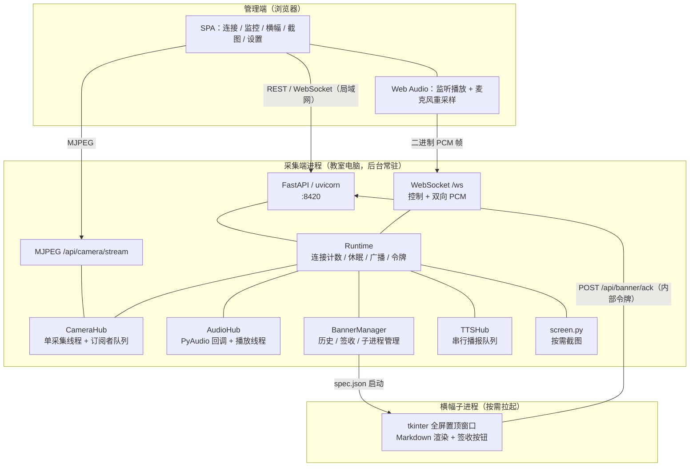
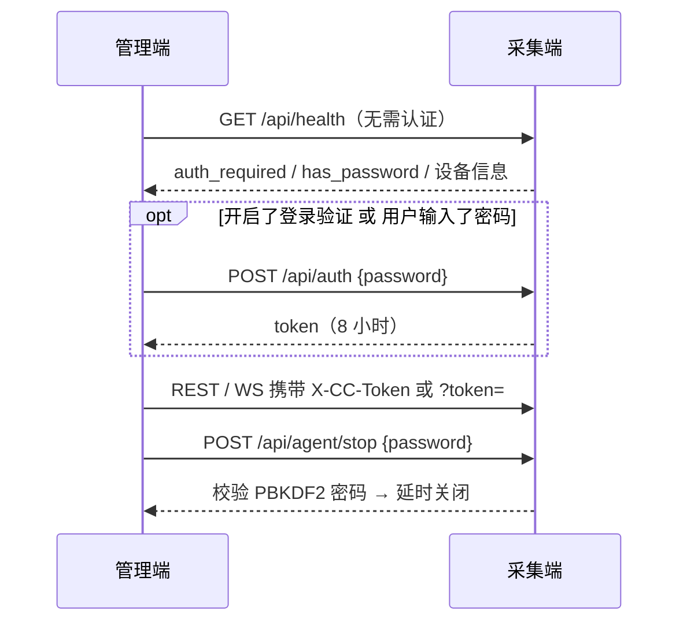

# 架构设计与数据流

## 1. 总体拓扑

ClassConnector 采用「**采集端内置服务 + 纯静态管理端**」的单体部署形态，不需要中心服务器、消息中间件或数据库。



**关键点**：管理端页面既可以由采集端 `StaticFiles` 托管（`http://IP:端口` 直连自动识别），也可以整体复制到任意静态服务器，通过填写 IP + 端口跨源连接。服务端 CORS 放行 `*`，WebSocket 不校验 Origin，因此两种形态共用同一套 API。

---

## 2. 进程与线程模型

| 单元 | 类型 | 职责 | 生命周期 |
| --- | --- | --- | --- |
| uvicorn 主循环 | asyncio 事件循环 | HTTP、WebSocket、定时休眠检查（1s） | 进程全程 |
| `cc-camera` | 守护线程 | 打开摄像头 / 生成测试画面、JPEG 编码、广播到订阅队列 | 全程；休眠时阻塞等待 |
| PyAudio 输入回调 | PortAudio 线程 | 麦克风 PCM → `Runtime.broadcast_audio` | 有音频设备时 |
| `cc-audio-out` | 守护线程 | 对讲 PCM → 扬声器 | 全程 |
| `cc-tts` | 守护线程 | 串行执行 合成 → 播放 | 全程 |
| `cc-banner-watch` | 每横幅一个短线程 | 等待窗口子进程结束，更新「已关闭」状态 | 横幅期间 |
| 横幅窗口 | **独立子进程** | tkinter 全屏窗口、Markdown 渲染、签收上报 | 按需拉起，关闭即退出 |
| `cc-tray` | 可选守护线程 | 系统托盘菜单 | 安装 pystray 且图形会话可用时 |

**为什么横幅用独立子进程**：tkinter 在 macOS 上要求主线程、在部分环境会因线程问题崩溃；独立进程彻底隔离，窗口崩溃不会拖垮采集服务，且 Windows 可用 `pythonw.exe` 无控制台启动。签收通过本地 HTTP + 内部令牌回传，父进程无需与之共享内存。

**线程安全**：`Runtime.broadcast()` 会被采集线程、PortAudio 回调、TTS 线程调用。`asyncio.Queue` 只能在事件循环线程操作，因此跨线程调用统一通过 `loop.call_soon_threadsafe()` 投递；慢客户端队列满时丢弃最旧帧，避免音频/状态消息拖垮采集线程。

---

## 3. 数据流

### 3.1 视频（MJPEG）

```
OpenCV / 测试画面 → cv2.imencode(JPEG, quality)
    → CameraHub._publish() 广播到每个订阅者的 queue.Queue(maxsize=2)
    → /api/camera/stream 的 async generator 用 asyncio.to_thread 取帧
    → multipart/x-mixed-replace，每帧带 Content-Length
    → 浏览器  直接渲染
```

- 一次采集、多订阅者广播；画质参数是**设备级**配置（`/api/camera/config`），修改后 `_reload_event` 触发重新打开设备。
- 无摄像头 / OpenCV 缺失 / 读取中断时，只探测一次设备后置 `_cap_failed`，之后稳定输出测试画面，不会逐帧重试拖垮帧率。
- 每个流订阅都计入 `Runtime.stream_clients`，保持采集端唤醒；断开时 `finally` 中递减。

### 3.2 音频

统一格式：**16 kHz / 单声道 / 16-bit PCM**。

```
监听：PyAudio 输入回调 → broadcast_audio() → WS 二进制帧
      → 浏览器 PcmPlayer 排队到 AudioContext（自动重采样到 48kHz）
对讲：浏览器 getUserMedia → AudioWorklet（回退 ScriptProcessor）
      → 线性插值重采样 48k→16k → Int16 → WS 二进制帧
      → AudioHub.play() → 输出队列 → PyAudio 扬声器
```

- `talk_mode=true` 时 `broadcast_audio()` 直接丢弃监听帧，同时清空输出缓冲，避免回声与啸叫。
- 浏览器端对讲与监听互斥：开启对讲立即 `player.stop()`，结束后若原本在监听则 `enable()` 恢复。

### 3.3 横幅通知

```
管理端 POST /api/banner/send
    → BannerManager 规范化 + 写入历史（OrderedDict，上限 100）
    → 关闭上一条横幅（terminate 旧窗口进程）
    → _spawn：写 spec.json，拉起 python -m agent.banner_window
    → 并行：TTSHub.speak(标题+正文, urgent) → 警报音(紧急) + Edge TTS mp3
    → WS 广播 banner / banner_ack / banner_dismissed
```

- 无图形桌面会话（Linux 无 `DISPLAY`）时不拉起窗口，广播 `banner_headless`，管理端用「网页预览」呈现，签收状态仍可记录。
- 签收：`banner_window` 子进程 `POST /api/banner/ack`，携带 `X-CC-Token: <internal_token>`；服务端据此把来源标记为 `desktop`，管理端代签收标记为 `web`。
- `duration > 0` 时服务端 `threading.Timer` 自动撤回；窗口内也有倒计时。

### 3.4 截图

`GET /api/screen/shot` 按需同步执行：`mss` → `Pillow.ImageGrab` → 占位图。响应头 `X-CC-Fallback` 与 `X-CC-Meta`（`ensure_ascii` 保证 HTTP 头合法）让管理端区分真实截图与降级图。截图请求会短暂唤醒采集端，但不计入长连接，超时后重新休眠。

---

## 4. 休眠状态机

`active = len(ws_clients) + stream_clients`

| 条件 | 动作 |
| --- | --- |
| `active > 0` | `wake()`：恢复摄像头/音频线程，广播 status |
| `active == 0` 且 `now - last_active >= idle_timeout` | `sleep()`：`camera.pause()` 释放设备、`audio.pause()` 关闭流，广播 status |
| 任意 API 调用 `runtime.touch()`（快照、截图） | 更新活动时间；若正在休眠则立即唤醒 |
| `idle_timeout = 0` | 禁用休眠 |

休眠只影响**采集**资源；HTTP/WebSocket、横幅、TTS、托盘、退出密码校验始终在线，因此管理端随时可以重新接入。

---

## 5. 认证与权限



| 操作 | 是否需要密码 | 是否需要令牌 |
| --- | --- | --- |
| 查看健康检查、静态页面 | 否 | 否 |
| 观看画面、发通知、截图、改画质、对讲 | 否（可配置） | `require_auth=true` 时需要 |
| 开启/关闭 `require_auth` | **是** | 需要 |
| 修改安装密码 | **是**（旧密码） | 需要 |
| 退出 / 重启采集端 | **是** | 不需要（密码本身即认证） |
| 关闭开机自启（本地命令） | **是** | 不需要 |
| 横幅子进程回传签收 | 内部令牌 | 内部令牌 |

密码哈希与盐写在用户目录配置中（权限 `0600`），`cfg.public()` 会剔除后再返回给管理端。修改密码或切换 `require_auth` 时 `revoke_tokens()` 清空所有会话。

---

## 6. 降级策略汇总

| 场景 | 行为 |
| --- | --- |
| 无 OpenCV / 无摄像头 | 动态测试画面（含班级、IP、时间），`camera.available=false` |
| 无 Pillow | 1×1 兜底 JPEG；截图返回最小占位 |
| 无 PyAudio | 音频不可用标记；对讲 PCM 静默丢弃，不阻塞 |
| 无 edge-tts / 断网 | 跳过朗读，写日志；横幅与警报音照常 |
| 无 pygame / ffplay | 依次尝试 Windows MediaPlayer / winsound / afplay / aplay |
| 无图形桌面 | 横幅不弹窗，管理端网页预览；截图返回占位图 |
| 无 pystray | 无托盘，网页仍可管理 |

所有降级都能在 `GET /api/status` 的 `capabilities` 与各模块 `status()` 中查到，管理端「设备设置 → 能力检测」直接展示。

---

## 7. 带宽与性能参考

单路 1280×720 / 质量 70 / 15 fps 的 MJPEG 约 **1.5–4 Mbps**（取决于画面复杂度）；音频监听 16 kHz×16 bit = **256 kbps**。一个采集端支持多个管理端观看，视频只编码一次。

降低负载的方式：把画质调到 40–55、分辨率 640×480、帧率 10 fps；或提高 `idle_timeout` 之外让无人观看时尽快休眠。

---

## 8. 扩展点

- **多设备管理**：管理端 `localStorage` 保存设备列表，切换时重新走 `health → auth → ws` 流程。
- **更换紧急音频**：把任意 wav 放到 `<数据目录>/urgent.wav` 即可覆盖内置警报。
- **更换推流协议**：`CameraHub` 已把「采集」与「分发」解耦，可把 MJPEG generator 换成 WebSocket 二进制帧或 WebRTC。
- **持久化历史**：`BannerManager.history` 目前是内存 `OrderedDict`，可替换为 SQLite，接口不变。
- **集中认证**：把 `Runtime.valid_token` 换成对接统一身份服务即可。
